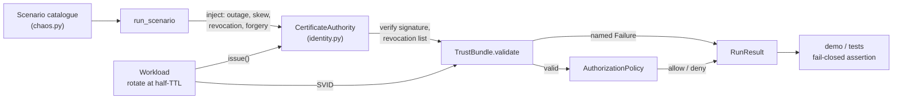

# rotationchaos

Workload identity with 60-second certificates and injected rotation failures, so the rotation path runs thousands of times an hour instead of once a year.

[](https://github.com/SlateGitOrg/rotationchaos/actions/workflows/ci.yml)

## Why

Teams adopt mTLS and workload identity, everything works, and fourteen months later a certificate expires at three in the morning and half the estate cannot talk to the other half. The rotation logic was never exercised because certificates were long-lived and nobody waited a year to test them. The outage is the first integration test.

rotationchaos runs SPIFFE-style identities (SVIDs) with a 60-second TTL and injects failures while requests are in flight: CA outage, clock skew, revocation mid-connection, forged and foreign certificates, missing identity, and policy denial. Every failure is asserted to **fail closed**. A mesh that fails open under CA outage stays green on availability dashboards while having silently switched off authentication.

## Features

- SPIFFE-style SVIDs issued by a simulated CA with 60-second lifetimes, HMAC-SHA256 signed.
- Trust-bundle validation that returns a named failure (expired, not yet valid, untrusted CA, revoked, bad signature, no identity) instead of a boolean.
- Workload rotation at half-TTL that keeps the current identity when the CA is unreachable.
- A catalogue of nine scenarios (one steady state, eight failures), each with its expected denial reason written down.
- A fail-open detector: any request allowed after denial has begun is flagged.
- Authorization keyed on SPIFFE ID with deny-by-default.
- Standard library only, no dependencies.

## Architecture



`run_scenario` drives a simulated clock one second per request. Each tick the workload rotates if half its TTL has elapsed, then the caller's SVID is validated against the trust bundle (with an optional verifier clock skew) and finally checked against the authorization policy. Every denial is recorded with its reason, and `RunResult.failed_open` is true if any request was allowed after the first denial.

## Quick start

Requires Python 3.11+. There is nothing to install.

```bash
git clone https://github.com/SlateGitOrg/rotationchaos.git
cd rotationchaos
python -m unittest discover -s tests -v   # 15 tests
python -m src.demo                        # run all nine scenarios
```

## Example

Output of `python -m src.demo` (trimmed):

```text
  Steady state: 50,000 requests, 1,666 rotations, 0 failures.

  scenario                     requests  allowed  denied  first deny  verdict
  steady_state                      500      500       0           -  healthy
  ca_outage                         500       59     441         #59  FAIL-CLOSED
  clock_skew_forward                500        0     500          #0  FAIL-CLOSED
  clock_skew_backward               500        0     500          #0  FAIL-CLOSED
  mid_connection_revocation         500       10     490         #10  FAIL-CLOSED
  untrusted_ca                      500        0     500          #0  FAIL-CLOSED
  forged_svid                       500        0     500          #0  FAIL-CLOSED
  no_identity                       500        0     500          #0  FAIL-CLOSED
  policy_denied                     500        0     500          #0  FAIL-CLOSED

  All fail-closed scenarios held: True
```

## How it works

| Scenario | Injected condition | Expected denial |
|----------|--------------------|-----------------|
| `steady_state` | none | no denials |
| `ca_outage` | CA goes down at request 10 | `svid expired` |
| `clock_skew_forward` | verifier clock 10 min fast | `svid expired` |
| `clock_skew_backward` | verifier clock 10 min slow | `svid not yet valid` |
| `mid_connection_revocation` | SVID revoked at request 10 | `svid revoked` |
| `untrusted_ca` | SVID from a foreign CA | `issuing CA is not in the trust bundle` |
| `forged_svid` | corrupted signature | `svid signature invalid` |
| `no_identity` | workload never got an SVID | `workload has no svid` |
| `policy_denied` | valid identity, caller not permitted | `spiffe id not permitted by policy` |

Design notes:

- **Failed rotation keeps the old SVID.** Discarding the current identity before the new one arrives turns a transient CA blip into a guaranteed outage. In `ca_outage` the workload keeps serving on its existing certificate for the remainder of its 60 seconds (59 requests), then denies.
- **The CA returns `None` rather than raising** when unavailable, forcing the caller to decide explicitly what to do without an identity, which is where fail-open tends to creep in.
- **Rotate at half-TTL.** Rotating too late means every workload rotates at the same moment when the CA recovers from a blip.
- **Skew is a verifier property.** Modelling it on the validator reproduces how valid certificates get rejected across a fleet at once.
- **Fail-closed is checked as a trajectory**, not per request: once denial starts, no later request may be allowed.

See [docs/ARCHITECTURE.md](docs/ARCHITECTURE.md) for context, decisions and failure modes.

## Testing

```bash
python -m unittest discover -s tests -v
```

The 15 tests cover: 50,000 steady-state rotations with zero failed requests; rotation well before expiry; all eight failure scenarios denying with the documented reason and never failing open; the exclusive expiry boundary; "not yet valid" distinct from "expired"; named failures for missing identity and foreign CA; immediate revocation; rotation failure retaining the current identity and recovering when the CA returns; and identity-keyed, deny-by-default authorization.

## Project layout

```
src/identity.py   SVID, CertificateAuthority, TrustBundle, Workload, AuthorizationPolicy
src/chaos.py      scenario catalogue and run_scenario driver
src/demo.py       CLI that runs every scenario and prints the verdict table
tests/            unittest suite
docs/             architecture notes
```

## Limitations

- A simulation, not a mesh: the CA, signing (HMAC with a shared secret instead of X.509) and clock are in-process models.
- No SPIRE, Envoy or Kubernetes integration; the scenarios model their behaviour, they do not drive real components.
- Educational and not security-audited. Do not use for production identity.

## License

MIT — see [LICENSE](LICENSE).
