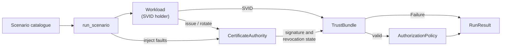

# Architecture

## Context

Short-lived workload certificates are only safe if the rotation path is reliable, and rotation is rarely exercised when certificates last a year. rotationchaos shrinks the TTL to 60 seconds in a deterministic simulation and injects failures, so the behaviour of rotation, validation and authorization under fault is observable and testable in milliseconds.

## Components

- `identity.py`: SVIDs (frozen dataclass), the CA (issues, signs, revokes, can be made unavailable), the trust bundle (validates and returns a named `Failure`), the workload (rotates, retains its SVID on failure) and the identity-keyed authorization policy.
- `chaos.py`: the scenario catalogue and `run_scenario`, which advances a simulated clock one second per request and records allowed/denied counts, denial reasons, rotations and the index of the first denial.
- `demo.py`: runs every scenario and prints a verdict table.

## Key decisions

- **Fail closed everywhere.** Every failure maps to a named `Failure`, and a failure always means denial. No scenario in the catalogue has "allow" as the correct answer.
- **Expected outcomes are written before the injector.** Each `Scenario` states the denial reason it must produce, so a test asserts a specific outcome rather than "it handled it".
- **Rotation failure retains the current SVID.** The alternative, dropping the identity first, makes a CA blip an outage. Trade-off: a workload can serve on a certificate that was revoked or is about to expire until validation catches it; validation, not rotation, is the enforcement point.
- **Fail-open is detected as a trajectory.** `RunResult.failed_open` is true if any request is allowed after denial has started. Under `ca_outage` the mesh correctly keeps allowing until the existing SVID expires; it must never flip back.
- **Validation order:** missing identity, untrusted CA, signature, revocation, then validity window with verifier clock skew applied.

## Failure modes

| Condition | Detection | Behaviour |
|-----------|-----------|-----------|
| CA unreachable | `issue()` returns `None` | rotation fails, old SVID kept, denial once it expires |
| Verifier clock skew | observed time outside validity window | `svid expired` or `svid not yet valid` |
| Revocation during connection | serial in CA revocation set | denied on the next request |
| Foreign or forged SVID | CA not in bundle, or HMAC mismatch | denied |
| No identity | `svid is None` | denied |
| Unlisted caller or callee | policy lookup | denied by default |

## Out of scope

- Real X.509, SPIFFE Workload API, SPIRE, Envoy and Kubernetes.
- Network behaviour, concurrency and partial rollout across many workloads.
- Production hardening or a security audit.
